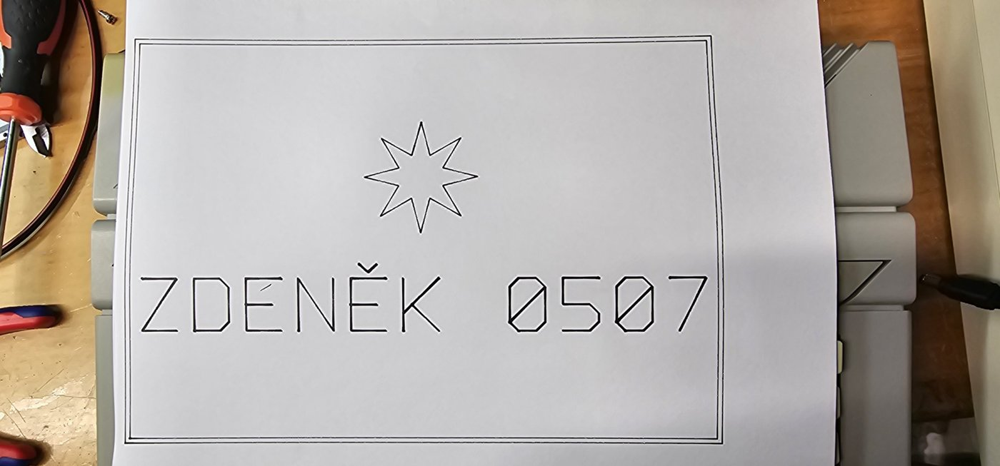
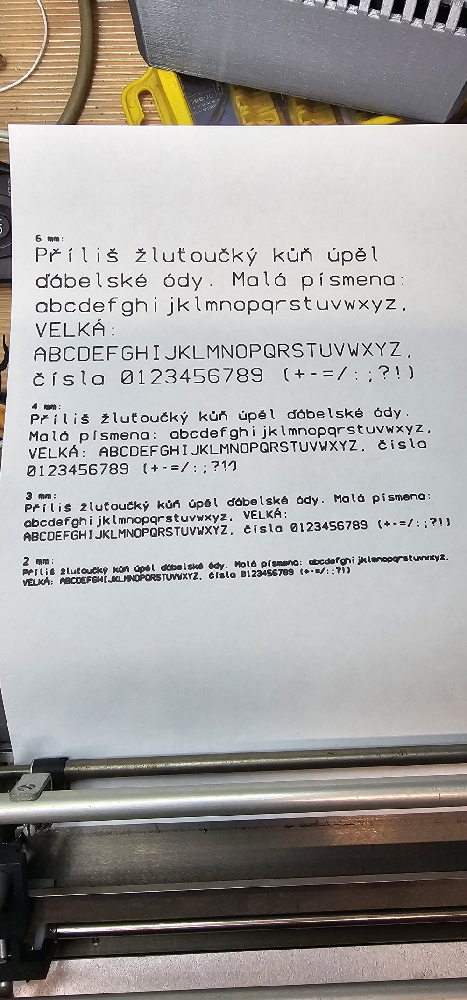

# Minigraf 0507 – control with Arduino Nano Every

🇨🇿 [Česky](README.md) · 🇬🇧 **English**

An interface that brings the Czechoslovak **Aritma Minigraf A 0507** pen plotter back to life and lets you
plot from an **Atari XE/XL** computer (via SIO) and from a **PC** (via USB).



*Author: Zdeněk Kotrba · © 2026 · version 0.2 (firmware 0.2)*

---

## Features

- **From the Atari** you plot with a plain `LPRINT` – the Arduino appears on the SIO bus as printer **P1:**.
- **From a PC** you plot HPGL files (e.g. from Inkscape) and lettering in a built-in stroke font with Czech diacritics.
- Simplified **HPGL commands**: `IN`, `PU`, `PD`, `PA`, `PR`, `CI`, plus `VS` (speed) and `PT` (pen delay).
- **Handshaking** – the next command is sent only after the plotter has finished the previous one; nothing gets lost.
- **Gradual acceleration and deceleration** of the motors, tested up to 80 mm/s (default 60 mm/s).
- The Atari is **galvanically isolated** by three CNY75C optocouplers.

```
Atari XE ──SIO──[3× optocoupler]── Arduino ──7 signals── Minigraf A 0507
                                      │
                                     USB
                                      │
                                      PC
```

## Repository layout

| Path | Content |
|---|---|
| `firmware/minigraf_sio/minigraf_sio.ino` | firmware for Arduino Nano Every (ATmega4809) and Leonardo/Micro (ATmega32U4) |
| `pc/plot.py` | sending HPGL files from a PC |
| `pc/text_plot.py` | lettering, text in lines and test page |
| `docs/Minigraf_0507_manual_v0.2_EN.pdf` | full manual in English (wiring, commands, examples, troubleshooting) |
| `docs/Minigraf_0507_navod_v0.2.pdf` | full manual in Czech |
| `docs/img/` | schematics (EN and CZ) and photos of results |

## Hardware

| Signal | Nano Every | Leonardo / Micro | Minigraf pin |
|---|---|---|---|
| SIO Data Out (via OK1) | D0 (RX1) | D0 (RX1) | – |
| SIO Data In (via OK3) | D1 (TX1) | D1 (TX1) | – |
| SIO Command (via OK2) | D2 | D2 | – |
| X1 / X2 / X4 | A0 / A1 / A2 | A0 / A1 / A2 | 10 / 9 / 8 |
| Y1 / Y2 / Y4 | A3 / **A6** / **A7** | A3 / A4 / A5 | 4 / 3 / 2 |
| P (pen) | D10 | D10 | 5 |
| GND | GND | GND | 1, 11 |

**Plotter connector:** edge connector with 2.54 mm pitch (same type as ZX Spectrum bus peripherals),
12 positions, **position 7 is a key** and counts in the numbering. Only the bottom row of contacts is used.


> ⚠️ Atari ground and Arduino/plotter ground must **never be connected** – that is what the optocouplers are for.
> The Arduino is powered from USB, the plotter from its own 24 V supply.

Schematics: [Nano Every](docs/img/schema_nano_every_en.jpg) · [Leonardo / Micro](docs/img/schema_leonardo_micro_en.jpg)

## Quick start

### 1. Firmware
1. Arduino IDE → Boards Manager → install **Arduino megaAVR Boards**.
2. Board **Arduino Nano Every**, open `firmware/minigraf_sio/minigraf_sio.ino` and upload.

### 2. Plotting from Atari BASIC
```basic
10 LPRINT "IN;"
20 LPRINT "PU100,100;PD1400,100,1400,2000,100,2000,100,100;"
30 LPRINT "PU750,1050;CI400;"
40 LPRINT "PU0,0;"
```

### 3. Plotting from a PC (Windows)
```
py -m pip install pyserial
cd pc
py text_plot.py "HELLO" --frame --bold 3 --send
py text_plot.py --test --portrait --send
py plot.py drawing.hpgl
```
Faster drawing of small text: `py text_plot.py --test --portrait --send --accel 6000,250 --diag 0`

The default port is `COM4` (another one: `py plot.py COM7 drawing.hpgl` or `--port COM7`).
Before plotting, move the head to the bottom-left corner – that becomes point 0,0.

## Command reference

| Command | Meaning |
|---|---|
| `IN;` | current position = 0,0, pen up |
| `PU x,y;` | pen up and move |
| `PD x,y,...;` | pen down and draw |
| `PA;` / `PR;` | absolute / relative coordinates |
| `CI r[,n];` | circle of radius r around the current position |
| `VS v;` | speed in mm/s (`VS;` = default 60) |
| `PT d,u;` | pen delay in ms after pen down / pen up (`PT;` = 0 / 70) |
| `AC s,r;` | acceleration: start delay s µs, shortened by r µs per step (`AC;` = 9000 / 150) |
| `DG0;` / `DG1;` | diagonal lines at full speed / slowed ×1.4 (`DG;` = 1) |
| `?` | USB only: firmware version and status |

Unit = 1 step = 0.125 mm. Plotting area 1504 × 2104 steps (188 × 263 mm).



See the [PDF manual](docs/Minigraf_0507_manual_v0.2_EN.pdf) for details.
Note: the firmware and the PC programs print their status messages in Czech.

## Version history

- **0.2** – `AC` (acceleration) and `DG` (diagonal lines) commands, firmware version in `?` status and in the PC programs (`--version`), `--accel` and `--diag` options.
- **0.1** – first version: P1: printer emulation for Atari, PC control, lettering and text.

## Sources

- Connector pinout: [cygnus.speccy.cz – Aritma Minigraf 0507](https://cygnus.speccy.cz/popis_printer-aritma0507.php)
- Signal meaning: MZXR documentation for the ZX Spectrum, Minigraf emulation in the MAME project

## License

[MIT](LICENSE) © 2026 Zdeněk Kotrba
