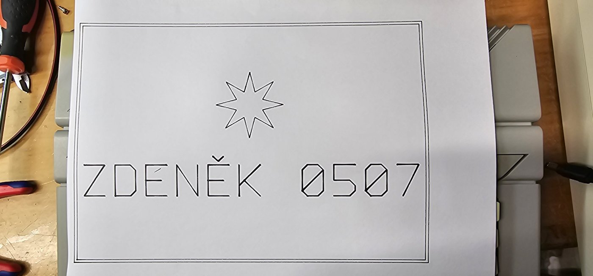
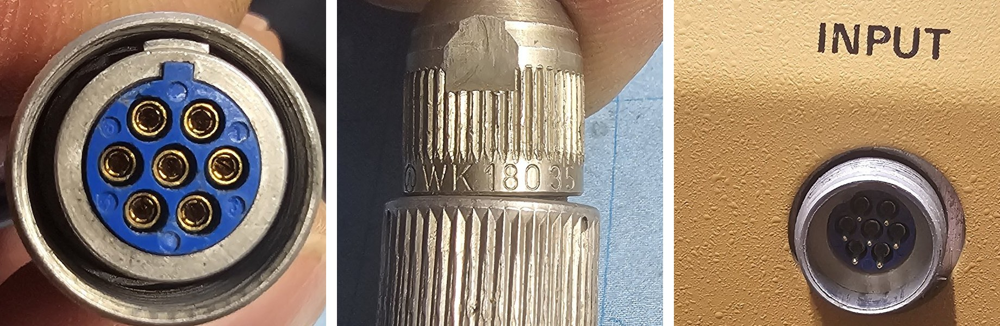
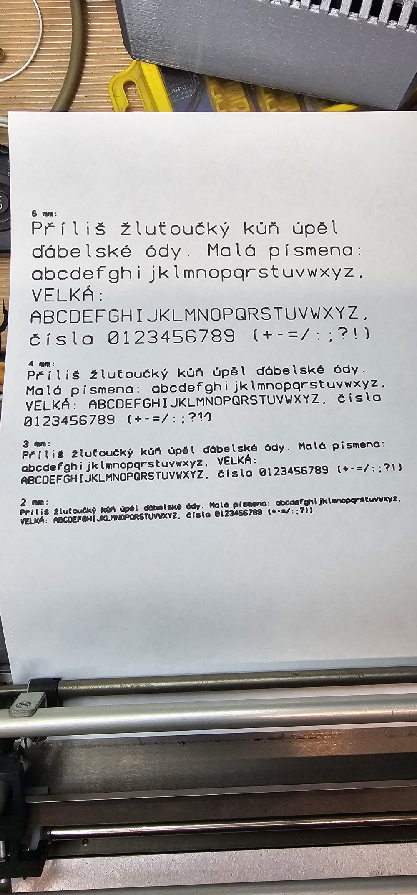
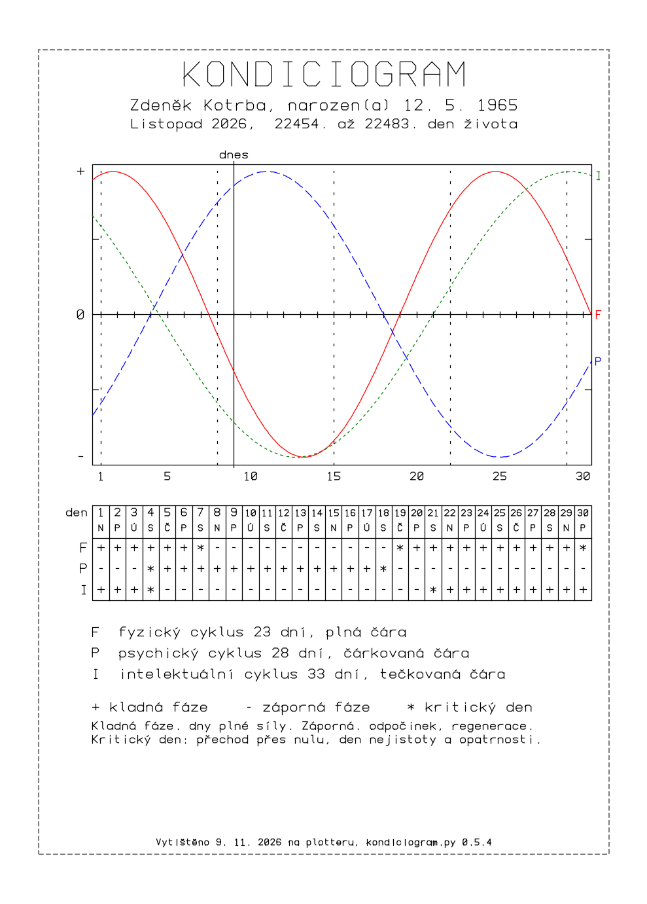
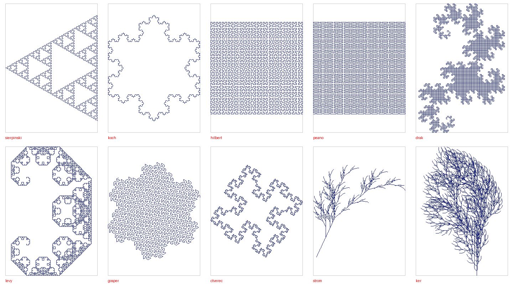
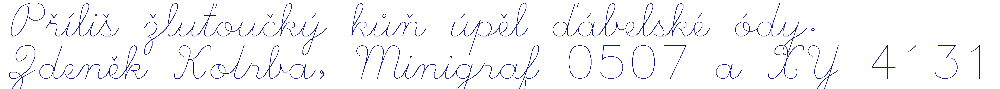
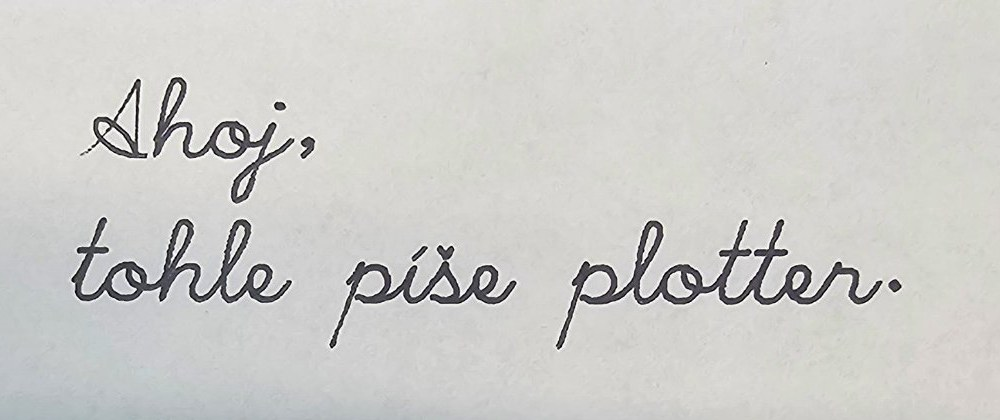

# Minigraf 0507 a XY 4131 – ovládání pomocí Arduino Nano Every

🇨🇿 **Česky** · 🇬🇧 [English](README.en.md)

Převodník, který oživí československé plottery **Aritma Minigraf A 0507** a **Aritma XY 4131** a umožní na nich kreslit
z počítače **Atari XE/XL** (přes SIO) i z **PC** (přes USB).



*Autor: Zdeněk Kotrba · © 2026 · verze 0.5.11 (firmware 0.5.2)*

---

## Co umí

- **Z Atari** se kreslí obyčejným `LPRINT` – Arduino se na sběrnici SIO hlásí jako tiskárna **P1:**.
- **Z PC** se kreslí HPGL soubory (např. z Inkscape) a nápisy vlastním čárovým písmem s českou diakritikou.
- Zjednodušené **HPGL příkazy**: `IN`, `PU`, `PD`, `PA`, `PR`, `CI`, plus `VS` (rychlost) a `PT` (prodleva pera).
- **Potvrzování** – další příkaz přijde, až plotter dokreslí předchozí, nic se neztratí.
- **Pozvolný rozjezd a dojezd** motorů, ověřeno do 80 mm/s (výchozí 60 mm/s).
- Atari je od zbytku **galvanicky odděleno** třemi optočleny CNY75C.
- Od verze 0.4.0 ovládá stejné Arduino i plotter **XY 4131** – oba plottery mohou být připojené současně, kreslí ten vybraný příkazem `PL`.

```
Atari XE ──SIO──[3× optočlen]── Arduino ──7 signálů── Minigraf A 0507
                                   │       └─5 signálů── XY 4131
                                   │
                                  USB
                                   │
                                   PC
```

## Struktura repozitáře

| Cesta | Obsah |
|---|---|
| `firmware/minigraf_sio/minigraf_sio.ino` | firmware pro Arduino Nano Every (ATmega4809) a Leonardo/Micro (ATmega32U4), Minigraf i XY 4131 |
| `firmware/xy4131_test/xy4131_test.ino` | testovací program pro oživení XY 4131 (ovládání jednotlivých signálů) |
| `pc/plot.py` | posílání HPGL souborů z PC |
| `pc/text_plot.py` | nápisy, text v řádcích a zkušební stránka, blokové i psací písmo |
| `pc/sierpinski.py` | Sierpińského trojúhelník jedním tahem (`py sierpinski.py --send`) |
| `pc/fraktaly.py` | deset fraktálů (Koch, Hilbert, drak, Gosper, rostlina …), většina jedním tahem (`py fraktaly.py --list`) |
| `pc/kondiciogram.py` | kondiciogram – biorytmy na zvolený měsíc (`py kondiciogram.py 12.5.1965 11/2026 --send`) |
| `pc/mzxr_tap.py` | tisk obrázků pro ZX Spectrum + ovladač MZXR přímo ze souboru `.tap` (např. tramvaj T3 od Cygnuse z [cygnus.speccy.cz](https://cygnus.speccy.cz/popis_printer-aritma0507.php)) |
| `pc/hershey_script.py` | data psacího písma (`--font psane`), musí být ve stejné složce jako `text_plot.py` |
| `docs/Minigraf_0507_XY4131_navod_v0.5.11.pdf` | kompletní návod česky (zapojení, příkazy, ukázky, řešení problémů) |
| `docs/Minigraf_0507_XY4131_manual_v0.5.11_EN.pdf` | kompletní návod anglicky |
| `docs/img/` | schémata zapojení (CZ i EN) a fotky výsledků |

## Hardware

| Signál | Nano Every | Leonardo / Micro | Minigraf vývod |
|---|---|---|---|
| SIO Data Out (přes OK1) | D0 (RX1) | D0 (RX1) | – |
| SIO Data In (přes OK3) | D1 (TX1) | D1 (TX1) | – |
| SIO Command (přes OK2) | D2 | D2 | – |
| X1 / X2 / X4 | A0 / A1 / A2 | A0 / A1 / A2 | 10 / 9 / 8 |
| Y1 / Y2 / Y4 | A3 / **A6** / **A7** | A3 / A4 / A5 | 4 / 3 / 2 |
| P (pero) | D10 | D10 | 5 |
| GND | GND | GND | 1, 11 |

**Konektor plotteru:** okrajový konektor s roztečí 2,54 mm (stejný typ jako u periferií ZX Spectra),
12 pozic, **na pozici 7 je zámek** a při číslování se počítá. Používá se jen spodní řada kontaktů.


> ⚠️ Zem Atari a zem Arduina s plotterem se **nespojují** – proto jsou v obvodu optočleny.
> Arduino se napájí z USB, plotter ze svého zdroje 24 V.

Schémata: [Nano Every](docs/img/schema_nano_every.jpg) · [Leonardo / Micro](docs/img/schema_leonardo_micro.jpg) · [XY 4131](docs/img/schema_xy4131.jpg)

### Plotter XY 4131 (od verze 0.4.0)

| Signál | Nano Every / Leonardo | Vývod INPUT | Význam (ověřeno) |
|---|---|---|---|
| PERO | D6 | 1 | 1 = pero dole (cívka), 0 = nahoru (pružina) |
| KROK | D3 | 2 | v klidu 1, impulz do 0 = krok 0,1 mm |
| X/Y | D5 | 3 | 0 = vozík (osa X), 1 = papír (osa Y) |
| +/− | D4 | 4 | vozík 1 = doprava, papír 1 = dopředu |
| READY | D7 | 5 | nepoužívá se |
| GND | GND | 6 | zem |

Konektor: na plotteru kulatá sedmipólová zásuvka **INPUT**, na kabelu vidlice TESLA **WK 180 35** s převlečnou maticí. Čísla vývodů jsou na modré vložce, vývod 7 (prostřední) se nezapojuje.



Doporučené 220 Ω v sérii s D3–D6. Plotter vybereš příkazem `PL4131;` (zpět `PL0507;`), volba se uloží do EEPROM. Přepnout ho jde ze Sériového monitoru, z PC (`py plot.py --select 0507`, nebo `--plotter 4131` přímo při kreslení) i z Atari (`LPRINT "PL0507;"`).
Krok 0,1 mm, dráha vozíku asi 180 mm (mez X = 1780), start po `HM` 10 mm od levého koncového kontaktu.
Programy pro PC si plotter zjistí z Arduina samy:
```
py text_plot.py "Zdeněk XY4131" --frame --star --bold 3 --send
```
> ⚠️ Plotter má na panelu **přepínač pera** – vypnutý = pero nereaguje. Koncové kontakty vozíku musí volně odskakovat:
> zaseknutý levý kontakt zablokuje i jízdu doprava.

## Rychlý start

### 1. Firmware
1. Arduino IDE → Správce desek → nainstaluj **Arduino megaAVR Boards**.
2. Deska **Arduino Nano Every**, otevři `firmware/minigraf_sio/minigraf_sio.ino` a nahraj.

### 2. Kreslení z Atari BASICu
```basic
10 LPRINT "HM;IN;"
20 LPRINT "PU100,100;PD1400,100,1400,2000,100,2000,100,100;"
30 LPRINT "PU750,1050;CI400;"
40 LPRINT "PU0,0;"
```

### 3. Kreslení z PC (Windows)
```
py -m pip install pyserial
cd pc
py text_plot.py "AHOJ" --frame --bold 3 --send
py text_plot.py "Zdeněk Kotrba" --font psane --frame --star --send
py text_plot.py --test --portrait --send
py plot.py obrazek.hpgl
```
Šetrnější kreslení (starší plotter): `py text_plot.py --test --portrait --send --accel 9000,150 --diag 1`

Výchozí port je `COM4` (jiný: `py plot.py COM7 obrazek.hpgl` nebo `--port COM7`).
Papír A4 zakládej **horní hranou k výřezům pod přítlačnými kolečky posuvu**. Před kreslením hlava sama najede na levý doraz a startovní pozici X = 60, Y = 144 (příkaz `HM`); vypne se volbou `--nohome`.

## Přehled příkazů

| Příkaz | Význam |
|---|---|
| `HM[x[,y]];` | najetí na levý doraz (X = 0), založený papír = Y 0, pak na start (výchozí 60,144) |
| `LM x[,y];` | meze plochy v krocích od dorazu, uloží se do EEPROM (výchozí 1580, 2284) |
| `IN;` | aktuální poloha = počátek kreslení 0,0, pero nahoru |
| `PU x,y;` | pero nahoru a přesun |
| `PD x,y,...;` | pero dolů a kreslení |
| `PA;` / `PR;` | absolutní / relativní souřadnice |
| `CI r[,n];` | kružnice o poloměru r kolem aktuální polohy |
| `VS v;` | rychlost v mm/s (`VS;` = výchozí 60) |
| `PT d,u;` | prodleva pera v ms po položení / zvednutí (`PT;` = 30 / 70) |
| `AC s,r;` | zrychlení: pauza při rozjezdu s µs, zkrácení r µs za krok (`AC;` = 6000 / 250) |
| `DG0;` / `DG1;` | šikmé čáry plnou rychlostí / zpomalené ×1,4 (`DG;` = 0) |
| `PL0507;` / `PL4131;` | výběr plotteru, uloží se do EEPROM (`PL;` = vypsat) |
| `AL1;` / `AL0;` | samozvednutí pera při tisku zapnout / vypnout (plot.py samo, z Atari vždy) |
| `SI n;` | výška písma v mm (velká písmena), výchozí 6 |
| `FN0;` / `FN1;` | písmo blokové / psané |
| `DI0;` / `DI1;` | text podél osy X / otočený o 90° |
| `LBtext` | napíše text od polohy pera (do konce řádku nebo `CHR$(3)`); čeština: `c^` = č, `a'` = á, `u*` = ů, UTF-8 nebo Kameníci |
| `?` | jen z USB: verze firmwaru a stav |

Jednotka = 1 krok plotteru: Minigraf 0,125 mm, XY 4131 0,1 mm. Výchozí hodnoty `VS`, `PT`, `AC` a meze `LM` má každý plotter své. Minigraf: kreslicí plocha od startovní pozice 1520 × 2140 kroků (190 × 267,5 mm) = A4 s okraji 10 mm po stranách a 15 mm nahoře a dole.



*Zkušební stránka 6 / 4 / 3 / 2 mm, fix 0,5 mm, výchozí nastavení verze 0.3.4.*
*Kaňka v posledním řádku u „JKLM“ vznikla tím, že se na USB ztratil jeden příkaz a verze 0.3.4 čekala 20 s
s perem dole, než ho poslala znovu. Od verze 0.3.5 firmware pero po 1 s sám zvedne a `plot.py` se zeptá už po 3 s.*

Podrobnosti najdeš v [PDF návodu](docs/Minigraf_0507_XY4131_navod_v0.5.11.pdf).

## Historie verzí

- **0.5.11** (programy pro PC a návody) – nový **`mzxr_tap.py`**: přečte kazetový soubor `.tap` s programy v BASICu pro ZX Spectrum a ovladač MZXR (`PRINT #7,ma,x,y;pd;…;pu`) a nakreslí je na Minigrafu nebo XY 4131 – např. tramvaj Tatra T3 „15 Kobylisy“ od Cygnuse (soubor `data_basic_tramvaj_ckd_t3.tap` si stáhni z [jeho stránky](https://cygnus.speccy.cz/popis_printer-aritma0507.php); v repozitáři kvůli autorským právům není).
- **0.5.10** (programy pro PC a návody) – po tisku se vrátí i **papír**: hlava a papír nejdřív couvnou do polohy prvního HM, pak `HM;` – vše je přesně jako před tiskem.
- **0.5.9** (programy pro PC a návody) – po dokončení tisku se hlava sama vrátí na doraz a start (`PU;HM;`), u všech programů (plot.py, text_plot.py, kondiciogram.py, fraktaly.py, sierpinski.py); s `--nohome` jen zvedne pero.
- **0.5.8** (firmware 0.5.2) – samozvednutí pera po 1 s **jen při tisku**: plot.py posílá na začátku `AL1;` a na konci `AL0;`, tisk z Atari ho má vždy; ruční příkazy ze Sériového monitoru pero nechají dole. Pero se zvedne i když visí neúplný řádek (dřív to blokovalo zvednutí a mohla vzniknout kaňka).
- **0.5.7** (programy pro PC a návody) – kondiciogram má výchozí datum narození 18.2.1975 (`NAROZENI_DEFAULT`), stačí `py kondiciogram.py --send` nebo `py kondiciogram.py 12/2026 --send`; datum narození a měsíc lze zadat v libovolném pořadí.
- **0.5.6** (programy pro PC a návody) – kondiciogram tiskne vždy dodatek „P.S. „Přéčinó byla chybná elektrónka E13 z našeho podniku Katóda Olomóc.““; jiný text `--ps "…"`, bez dodatku `--bez-ps`.
- **0.5.5** (programy pro PC a návody) – `kondiciogram.py --ps "…"` přidá dodatek P.S. pod legendu; v blokovém písmu přibyly české uvozovky „ “.
- **0.5.4** (programy pro PC a návody) – nový **`kondiciogram.py`**: biorytmy F/P/I (23/28/33 dní) na zvolený měsíc, graf a tabulka se znaménky `+` `-` `*`, volba `--pera` pro každou křivku jiným perem (plot.py počká na výměnu); v blokovém písmu přibyla `*`. Návody: kapitola 13.4. Firmware zůstává 0.5.1.



- **0.5.3** (jen návody) – nová kapitola 13 „Doplňkové programy: fraktály“: ovládání `fraktaly.py` a `sierpinski.py`, tabulka fraktálů a všech voleb, tipy.
- **0.5.2** (jen programy pro PC a návody) – během tisku uplynulý čas a odhad zbývajícího času, po tisku celkový tiskový čas (také v `plot_log.txt`); nový `fraktaly.py` s deseti fraktály. Firmware zůstává 0.5.1.


- **0.5.1** – spolehlivější USB: firmware čísluje přijaté řádky (`> #N …`, ve stavu `USB radku N`), `plot.py` podle toho pozná, jestli se ztratil příkaz (pošle znovu), nebo jen odpověď (nepošle – jinak by vznikla čára navíc); celá komunikace se zapisuje do `plot_log.txt`; firmware vypíše obsah zahozeného neúplného příkazu. Nový `sierpinski.py`.
- **0.5.0** – **text přímo z Atari**: firmware má v sobě blokové i psací písmo a nové příkazy `SI` (velikost), `FN` (písmo), `DI` (směr) a `LB` (text). Čeština zápisem `c^`/`a'`/`u*`, v UTF-8 nebo v kódování Kameníci. Generátor dat písem `tools/gen_font.py`. Firmware 27 kB (Nano Every 48 kB, Leonardo 28 kB – vejde se těsně).

```
10 LPRINT "HM;IN;SI8;FN1;"
20 LPRINT "PU100,1900;LBAhoj, tohle pi's^e Atari."
```

- **0.4.5** (jen návody) – fotka psacího písma nakresleného na Minigrafu A 0507.
- **0.4.4** (jen programy pro PC) – přepnutí plotteru z příkazového řádku: `py plot.py --select 0507` / `--select 4131`; `--plotter 0507/4131` v `plot.py` i `text_plot.py` plotter v Arduinu rovnou přepne. V návodu ukázka výběru plotteru z Atari BASICu. Firmware zůstává 0.4.2.
- **0.4.3** (jen `text_plot.py`) – **písmo jako psané rukou**: volba `--font psane` (Hersheyho jednotahové psací písmo s doplněnou českou diakritikou, data v `hershey_script.py`); text se zalamuje podle skutečné šířky písmen. Firmware zůstává 0.4.2.





*Psací písmo nakreslené na Minigrafu A 0507.*

- **0.4.2** – návod přejmenován na „Minigraf 0507 a XY 4131“ a doplněn o konektor XY 4131 (zásuvka INPUT, kabelová vidlice TESLA WK 180 35, fotky); opravené označení konektoru ve firmwaru, schématu a testovacím programu (0.10). Funkce firmwaru beze změny.
- **0.4.1** (jen firmware) – oprava: když byl převodník SIO odpojený (signál Command trvale L), firmware čekal jen na Atari, nereagoval na USB a LED neblikala. Teď to po 0,3 s ohlásí a dál obsluhuje USB; D2 má navíc vnitřní pull-up.
- **0.4.0** – podpora plotteru **Aritma XY 4131** ve stejném firmwaru (výběr `PL0507;` / `PL4131;`, uloží se do EEPROM; meze zvlášť pro každý plotter); `plot.py` a `text_plot.py` si plotter zjistí z Arduina a použijí správné měřítko a plochu (volba `--plotter`); testovací program `xy4131_test.ino`; návody s kapitolou o XY 4131.
- **0.3.8** – osa Y vztažená k založení papíru: start po `HM` je 60,144 a mez Y 2284, takže na A4 vyjdou okraje 10 / 10 / 15 / 15 mm (změřeno) a papír nevypadne z koleček posuvu; `text_plot.py` počítá s plochou 190 × 267,5 mm (výchozí `--margin` 8 / 5 mm).
- **0.3.5** – žádné kaňky při výpadku: firmware zvedne pero, když 1 s nepřijde příkaz; `plot.py` se zotaví už po 3 s.
- **0.3.4** – oprava příčiny výpadků: stavový výpis každých 10 s mohl zahltit 64bajtový přijímací buffer Arduina a uříznout příkaz; výpis se teď neposílá během kreslení a `plot.py` posílá řádky kratší než 64 znaků.
- **0.3.3** (jen programy pro PC) – `plot.py` před kreslením ověří, že firmware zná `HM` (verze 0.3 a novější), a zastaví se s jasnou hláškou, když hlava na nulu nenajede.
- **0.3.2** – nové výchozí hodnoty ověřené tiskem: zrychlení `AC6000,250`, šikmé čáry plnou rychlostí `DG0`, prodleva pera `PT30,70`.
- **0.3.1** – oprava: `plot.py` se sám zotaví z výpadku komunikace (po 20 s se zeptá Arduina a řádek pošle znovu), firmware zahodí neúplný příkaz, `plot.py` opět vypisuje verzi firmwaru.
- **0.3** – najetí na levý doraz `HM` (automaticky před každým výkresem z PC, `--nohome`), absolutní poloha a meze plochy `LM` uložené v EEPROM (ověřená mez X = 1580), `IN` už nehýbe motory.
- **0.2** – příkazy `AC` (zrychlení) a `DG` (šikmé čáry), verze firmwaru ve výpisu `?` a v programech pro PC (`--version`), volby `--accel` a `--diag`.
- **0.1** – první verze: emulace tiskárny P1: pro Atari, ovládání z PC, nápisy a text.

## Zdroje

- Zapojení konektoru: [cygnus.speccy.cz – Aritma Minigraf 0507](https://cygnus.speccy.cz/popis_printer-aritma0507.php)
- Význam signálů: dokumentace MZXR k ZX Spectru, emulace Minigrafu v projektu MAME

## Licence

[MIT](LICENSE) © 2026 Zdeněk Kotrba
